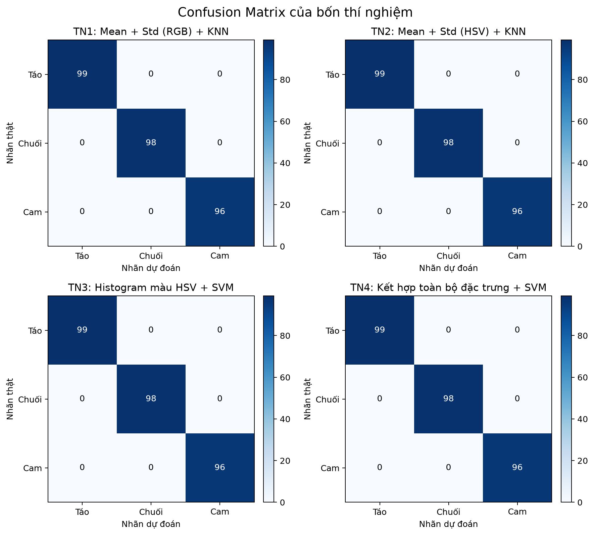
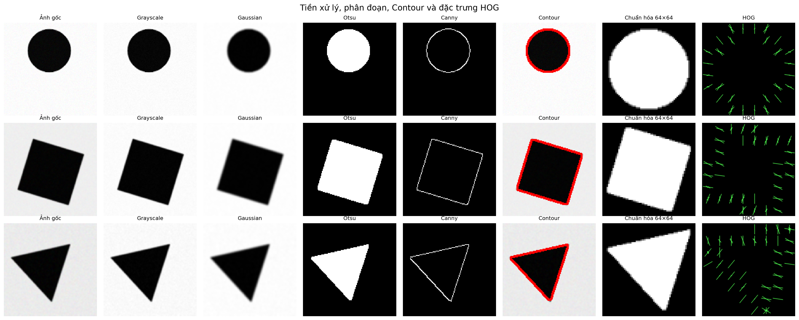

# THỰC HÀNH TUẦN 6 – XỬ LÝ ẢNH VÀ THỊ GIÁC ROBOT

## Nội dung bài làm

### Bài 1 – Phân loại táo, chuối và cam

Chương trình đọc 1.461 ảnh từ Fruits-360, đổi kích thước về 128×128, trích xuất đặc trưng màu và đánh giá bốn cấu hình trên cùng phép chia Train/Test 80/20 có phân tầng.

| Thí nghiệm | Đặc trưng | Số chiều | Mô hình |
|---|---|---:|---|
| TN1 | Mean + Standard Deviation RGB | 6 | KNN |
| TN2 | Mean + Standard Deviation HSV | 6 | KNN |
| TN3 | Histogram HSV | 50 | SVM |
| TN4 | RGB + HSV + Histogram HSV + Entropy | 63 | SVM |

Dữ liệu gồm 492 ảnh `Apple Braeburn 1`, 490 ảnh `Banana 1` và 479 ảnh `Orange 1`. Cả bốn thí nghiệm đạt Accuracy và F1-macro bằng 1,00 trên tập kiểm thử 293 ảnh.



### Bài 2 – Phân loại hình tròn, vuông và tam giác

Chương trình xử lý ảnh bằng Grayscale, Gaussian Blur, Otsu, Canny và Contour; sau đó trích 7 đặc trưng hình dạng và vector HOG 1.764 chiều. Ba nhóm đặc trưng `Shape`, `HOG`, `Combined` được kết hợp với KNN, SVM và Random Forest, tạo thành 9 thí nghiệm.

Dữ liệu chính có 900 ảnh (300 ảnh mỗi lớp) và tập ảnh mới có 15 ảnh (5 ảnh mỗi lớp). Trong bộ dữ liệu sinh tổng hợp có kiểm soát này, cả 9 thí nghiệm đạt Accuracy và F1-macro bằng 1,00. Kết quả 100% phản ánh dữ liệu hình học sạch và tách lớp rõ; không nên hiểu là mô hình sẽ luôn đạt 100% trên ảnh thực tế phức tạp.



## Cấu trúc thư mục

```text
XLA_th6/
├── README.md
├── requirements.txt
├── de_bai/
│   └── week6_ml.pdf
├── notebooks/
│   ├── bai1_phan_loai_trai_cay.ipynb
│   └── bai2_phan_loai_hinh_dang.ipynb
├── fruits-360-100x100-main/
│   ├── LICENSE
│   ├── README.md
│   └── Training/
│       ├── Apple Braeburn 1/
│       ├── Banana 1/
│       └── Orange 1/
└── tuan6/
    ├── bai1_phan_loai_trai_cay.py
    ├── bai2_phan_loai_hinh_dang.py
    ├── tao_du_lieu_hinh_hoc.py
    ├── requirements.txt
    ├── data/
    │   ├── shapes/
    │   └── shapes_external/
    ├── output_bai1/
    └── output_bai2/
```

## Cài đặt

Yêu cầu Python 3.10 trở lên. Tại thư mục gốc của kho mã nguồn, chạy:

```bash
python -m venv .venv
```

Kích hoạt môi trường trên Windows:

```powershell
.venv\Scripts\Activate.ps1
```

Cài thư viện:

```bash
python -m pip install --upgrade pip
python -m pip install -r requirements.txt
```

## Cách chạy

### Chạy bằng Jupyter Notebook

```bash
python -m pip install jupyter
jupyter notebook
```

Sau đó mở một trong hai file trong thư mục `notebooks` và chọn **Run All**.

### Chạy Bài 1 bằng Python

```bash
python tuan6/bai1_phan_loai_trai_cay.py
```

Dự đoán thêm ảnh bên ngoài:

```bash
python tuan6/bai1_phan_loai_trai_cay.py --du-doan duong_dan/anh1.jpg duong_dan/anh2.jpg
```

Kết quả được ghi vào `tuan6/output_bai1` gồm bảng đặc trưng, bảng chỉ số, biểu đồ, ma trận nhầm lẫn, ảnh dự đoán và bốn pipeline `.joblib`.

### Chạy Bài 2 bằng Python

Dữ liệu đã có sẵn. Nếu muốn sinh lại dữ liệu bằng đúng seed:

```bash
python tuan6/tao_du_lieu_hinh_hoc.py
```

Huấn luyện và đánh giá:

```bash
python tuan6/bai2_phan_loai_hinh_dang.py
```

Kết quả được ghi vào `tuan6/output_bai2` gồm đặc trưng Shape/HOG, bảng chỉ số, biểu đồ, ma trận nhầm lẫn, mô hình tốt nhất và dự đoán 15 ảnh mới.
